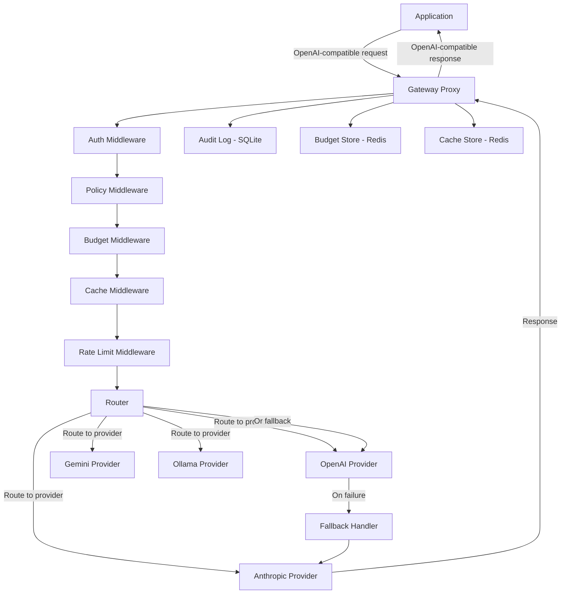

# LLM Gateway

[](https://github.com/FishRaposo/llm-gateway/actions/workflows/ci.yml) []() []() []()

**LLM proxy with routing, guardrails, cost control, and fallback.**

Route requests across multiple providers (OpenAI, Anthropic, Gemini, Ollama) with automatic failover, response caching, and per-API-key cost control.

[Quick Demo](#quick-demo) • [Case study](docs/portfolio-case-study.md) • [Architecture](#architecture) • [Configuration](#local-quickstart)

---

## Quick Demo

```bash
npm ci
make demo
```

No API keys, `.env` or Redis needed: builds the gateway, starts it on http://localhost:3000 with the
built-in mock provider, sends one OpenAI-compatible request and prints the 200 response. Without
provider keys `npm run dev` also serves mock completions (never automatically under
`NODE_ENV=production`; `/health` reports `"mock"`); set `MOCK_PROVIDER=false` to turn that off.

### Portfolio demo (dashboard UI)

The thesis: **the proxy is the control point** — routing, budgets, guardrails, and audit all
converge in one place. The optional Next.js dashboard (`dashboard/`) demonstrates that with
deterministic fixtures and an interactive **Simulate request** panel (provider fallback, budget
exceeded, guardrail blocked). Each button appends an audit row and updates budgets/health
consistently — no backend required.

```bash
make demo-ui          # http://localhost:3001 — forced demo mode
# equivalent:
cd dashboard && npm run demo:ui
```

Open http://localhost:3001.

**Click path:**

1. **Simulate request** → **Provider fallback** — audit log row shows primary failure and secondary provider success.
2. **Simulate request** → **Provider outage** — provider health flips to down, an error row lands; **Recover** restores health without rewriting the audit ledger.
3. **Simulate request** → **Budget exceeded** — request stopped; budget meter updates.
4. **Simulate request** → **Guardrail blocked** — policy violation recorded before the model call.
5. Scan **Provider health** and **Budgets** — every panel updates from one reducer state, so they stay consistent with the new log rows. **Reset** restores the fixture baseline.

Against a live gateway:

```bash
cd dashboard
npm install
NEXT_PUBLIC_GATEWAY_URL=http://localhost:3000 npm run dev
```

When the backend is unreachable the dashboard falls back to sample data automatically (shorter
outage banner). For portfolio previews, use forced demo mode (`make demo-ui`) which shows
*Sample data — deterministic gateway fixtures.*

---

## 1. What This Is

A lightweight LLM operations gateway for routing, cost control, fallback, and auditability. It sits between your applications and LLM providers (OpenAI, Anthropic, etc.), acting as an intelligent proxy that enforces policies, manages costs, and ensures reliability.

## 2. What Problem It Solves

LLM calls in production are **unmanaged costs** — no fallback when providers fail, no audit trail for compliance, no policy enforcement for safety, no cost visibility until the bill arrives. This gateway brings operational control to every LLM interaction:

- **Cost control**: Per-user budgets, rate limits, cost-optimized routing
- **Reliability**: Automatic fallback chains, circuit breakers, retry logic
- **Auditability**: Full request/response logging, usage analytics
- **Policy enforcement**: Content filtering, model restrictions, PII detection

## 3. Why Naive AI Systems Fail Here

Direct API calls from applications create several systemic problems:

- **Vendor lock-in**: Switching providers means rewriting integration code everywhere
- **No cost control**: A single runaway agent can rack up thousands in API costs
- **No resilience**: Provider outages take down your entire AI pipeline
- **No visibility**: You can't answer "how much did feature X cost last month?"
- **No governance**: No way to enforce which models can be used for what purpose

The gateway pattern solves all of these by centralizing LLM operations behind an OpenAI-compatible API.

## 4. Architecture



## 5. Local Quickstart

```bash
# Clone and install
git clone <repo-url> && cd llm-gateway
npm install

# Configure providers
cp .env.example .env
# Edit .env with your API keys

# Configure routing and policies
cp config/routing.example.yaml config/routing.yaml
cp config/policy.example.yaml config/policy.yaml
cp config/budgets.example.yaml config/budgets.yaml

# Start Redis (required for caching and rate limiting)
docker compose up redis -d

# Start the gateway
npm run dev
```

Send a request:

```bash
curl -X POST http://localhost:3000/v1/chat/completions \
  -H "Authorization: Bearer your-gateway-key" \
  -H "Content-Type: application/json" \
  -d '{
    "model": "gpt-4o-mini",
    "messages": [{"role": "user", "content": "Hello!"}]
  }'
```

## 6. Example Workflow

1. Application sends an OpenAI-compatible request to the gateway
2. **Auth** middleware validates the API key and resolves permissions
3. **Policy** middleware checks content against filtering rules and model restrictions
4. **Budget** middleware verifies the API key has remaining budget
5. **Cache** middleware checks if an identical request was recently answered
6. **Rate limit** middleware ensures the key hasn't exceeded request thresholds
7. **Router** evaluates routing rules to select the best provider and model
8. The chosen **provider adapter** translates and forwards the request
9. If the provider fails, the **fallback handler** tries the next provider in the chain
10. **Logging** middleware records the full request/response to the audit log
11. The response is returned to the application in OpenAI-compatible format

## 7. Key Design Decisions

| Decision | Rationale |
|----------|-----------|
| **Proxy pattern** | Applications only need one endpoint; switching providers is a config change |
| **Middleware chain** | Each concern (auth, caching, budget) is isolated, testable, and composable |
| **Redis for hot data** | Caching and rate limiting need sub-millisecond latency; Redis delivers |
| **SQLite for audit logs** | Append-heavy, query-light workload; SQLite avoids operational overhead |
| **OpenAI-compatible API** | Zero migration cost — existing OpenAI SDKs work by changing the base URL |
| **YAML configuration** | Routing rules and policies should be version-controlled alongside application code |

## 8. Failure Handling

- **Provider fallback**: If the primary provider returns an error, the fallback chain tries the next provider automatically. In streaming mode fallback is only allowed **before** any content has been emitted; once tokens have flowed the client gets an explicit partial-stream error instead of a disguised second completion.
- **Circuit breaker**: After repeated failures, a provider is temporarily removed from rotation
- **Timeout handling**: Configurable per-request timeouts prevent hanging connections
- **Retry logic**: Transient errors (rate limits, 5xx) are retried with exponential backoff
- **Client aborts**: disconnects propagate an `AbortSignal` into the provider stream so upstream work stops instead of running to completion.
- **Storage modes**: `STRICT_STORAGE=true` fails readiness when Redis/SQLite are unavailable; the default portable mode degrades budgets/cache/rate-limit to in-memory with explicit labeling, and Redis reconnects after a bounded backoff window.

## 9. Testing Strategy

The backend suite has **177 vitest tests** across 25 files; the optional dashboard has **41**
component/unit tests across 4 files plus **10 Playwright browser tests** (desktop + mobile,
including an axe accessibility suite). Run `npx vitest run` at the repo root and
`cd dashboard && npx vitest run` / `npx playwright test` for the UI.

```
tests/
├── routing.test.ts          # Rule evaluation, priority sorting, default fallback
├── fallback.test.ts         # Provider fallback chains, circuit breaker, retry limits
├── cache.test.ts            # Cache hits, misses, TTL expiry, key generation
├── budget.test.ts           # Budget tracking, limit enforcement, alerting
├── proxy.test.ts            # Full request pipeline, error handling, streaming
├── rateLimit.test.ts        # Sliding-window limiting, per-key config, 429 path
├── logging.test.ts          # Structured audit logging + API-key redaction
├── pricing.test.ts          # Frozen pricing parity snapshot (archived shared_core v1.3.0, golden-gated)
├── costService.test.ts      # Cost calc + model-pricing normalization
└── monitorAlignment.test.ts # Audit + Prometheus key parity with the Python monitor
```

- **Unit tests**: each middleware and service tested in isolation with mocks.
- **Integration tests**: full pipeline with the mock provider (no real API calls).
- **Concurrency/durability tests**: atomic budget reservation under contention, idempotent
  settle/release replay, SQLite persistence across restart, Redis outage/reconnect with a
  fake client (no Docker needed), and account-identity isolation across budget/audit/cache/rate-limit keys.
- **Stream-semantics tests**: pre-content-only fallback, single `[DONE]` terminator, explicit
  partial-stream errors, and abort propagation into provider streams.
- **Error path tests**: provider failures, budget exceeded, policy denied, rate limited.
- **Golden-output tests**: pricing/cost values are pinned so refactors can't silently move them.
- **Cross-language tests**: pin the frozen pricing lineage (archived `shared_core.pricing`
  v1.3.0) plus the audit cost-record columns and Prometheus key names shared with the
  Python `llm-cost-latency-monitor` (now consolidated into agenttrace).
- **Dashboard tests** (`dashboard/`): pure data helpers, the `ErrorBoundary`, and the
  console in demo / live / empty states.

## 10. Deployment Notes

```bash
# Build and run with Docker
docker compose up -d

# Scale horizontally behind a load balancer
# Redis shared state allows multiple gateway instances

# Environment-specific config
# - Use .env for local development
# - Use environment variables in production
# - Mount config/ volume for routing and policy YAML
```

## 11. Roadmap

- [x] Streaming support with SSE forwarding
- [x] Admin dashboard with usage visualization
- [x] Prometheus metrics endpoint (`/metrics`)
- [x] Atomic budget lifecycle (reserve/settle/release) with idempotent request accounting
- [x] Per-account identity across budgets, audit, cache, and rate limits
- [ ] Multi-region deployment support
- [ ] Webhook notifications for budget alerts
- [ ] Request/replay debugging tool
- [ ] Token counting and cost estimation before forwarding

## 12. What This Project Demonstrates

Middleware design, provider abstraction, cost management, reliability engineering, and API gateway patterns — the infrastructure layer that separates toy AI demos from production AI systems.

## Part of the stack

[groundtruth](https://github.com/FishRaposo/groundtruth) · [evalforge](https://github.com/FishRaposo/evalforge) · [aria-agent](https://github.com/FishRaposo/aria-agent) · [agenttrace](https://github.com/FishRaposo/agenttrace) · [WCP-Compliance-Agent-V5](https://github.com/FishRaposo/WCP-Compliance-Agent-V5)
